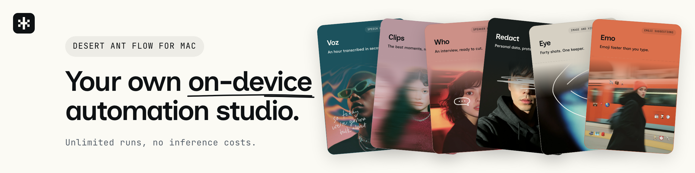
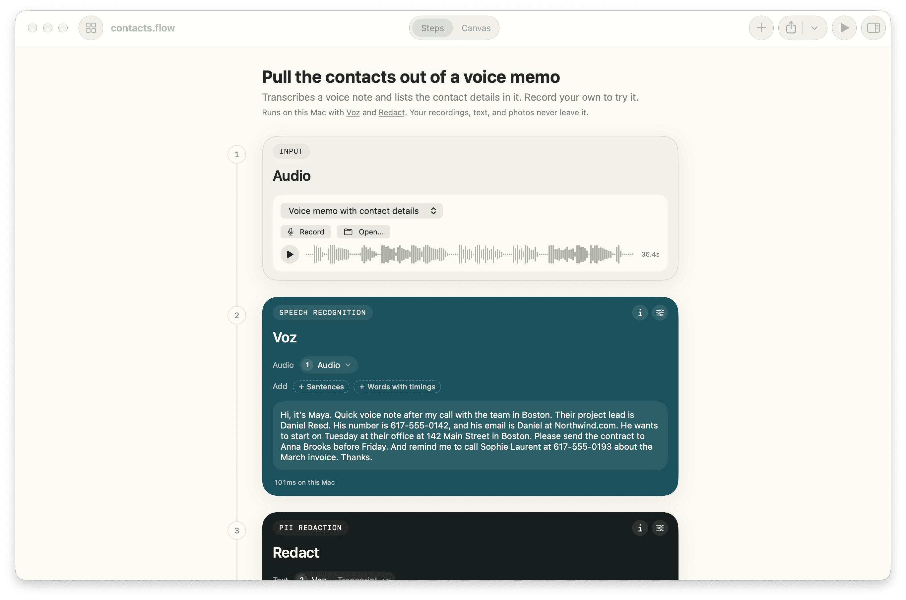
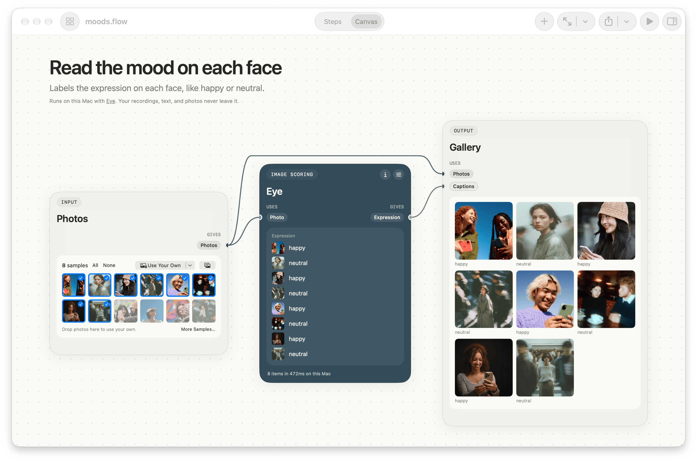
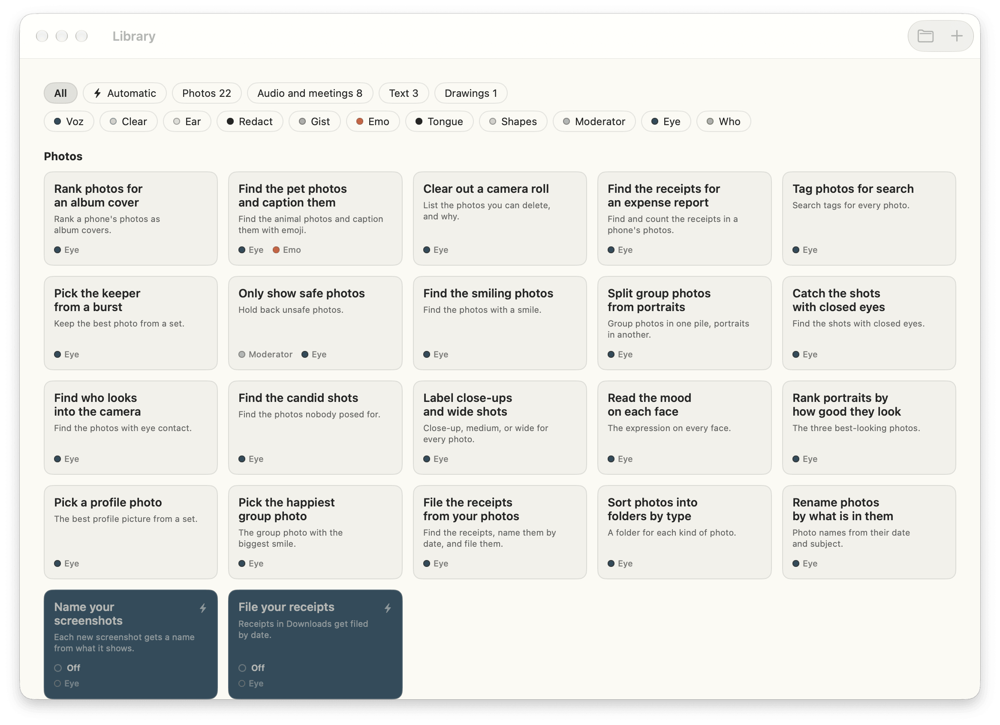

# Desert Ant Flow

Build flows out of [Desert Ant's on-device models](https://desertant.com/models/) and run them on your Mac. A flow can transcribe a voice memo and mask the personal details, find the smiling photos in a camera roll, or triage a support inbox. Your text, audio, and photos never leave your Mac. Download the [latest release](https://github.com/Desert-Ant-Labs/demo-flow/releases/latest) for macOS 26 or later on Apple Silicon.

<picture>
  <source media="(prefers-color-scheme: dark)" srcset="docs/screenshots/steps-dark.png">
  
</picture>

Desert Ant Flow is the Mac version of [flow.desertant.com](https://flow.desertant.com). Both save a flow as the same YAML file, and a share link from one opens in the other.

## Download

Download the [disk image](https://github.com/Desert-Ant-Labs/demo-flow/releases/latest), open it, and drag Desert Ant Flow to Applications. Flow needs macOS 26 or later on Apple Silicon. Flow checks for updates once a day with [Sparkle](https://sparkle-project.org) and asks before installing one.

Or install Flow with Homebrew:

```bash
brew tap desert-ant-labs/tap
brew install --cask desert-ant-flow
```

Homebrew 6 asks you to approve a tap when you add it first. Approving it covers Flow, and `brew trust desert-ant-labs/tap` covers every app Desert Ant publishes later.

## Features

- Build a flow as a list in Steps, where you pick each step's input from a menu. On the Canvas, drag a step's output to another step's input instead. Add Next Step lists the steps that fit after the selected one and connects the step you pick.
- Drop photos, recordings, videos, or text on a flow, paste them, or pick them in Finder or your Photos library. The Record step records from the microphone, or from the microphone and system audio during a call.
- The Result step copies, saves, and shares a result. Save to folder writes the result into a folder you pick, or beside the file the flow runs on: text as .txt or .md, a table as .csv, and photos, recordings, and videos as files.
- A flow can run on its own when a call starts, when files arrive in a folder, on a schedule, or when you press a shortcut. Turn this on in the flow's first step. Flow then runs the flow from the menu bar, and a small floater shows its progress.
- The Ask step pauses a flow until you answer: Yes or No before files move, unticking the photos a model got wrong, choosing from a few answers, or typing one. A flow that runs on its own asks in the floater and in a notification, and can go on with an answer you set once it has waited long enough.
- Show Results opens a pane beside the flow with every result at full size: photos as a wall you can filter by label, tables you can sort and copy, scores as a chart, and text set for reading. Export them all as a PDF, as Markdown, or as a folder with each result in its own file.
- The meeting notes template transcribes a call as it happens and labels who said what. Flow records you from the microphone and everyone else from system audio. Flow saves the notes under the meeting's title from your calendar. Click the floater to read the transcript in a see-through window that you can move anywhere, and to name the voices.
- Clips cuts the moments worth sharing out of a talk or a podcast, with the captions burned into the picture or saved beside each clip. Uhm lists every uh, um, and hmm with its time.
- Flow opens the flow files of the [desertant CLI](https://github.com/Desert-Ant-Labs/desert-ant-cli), and a flow runs the same in both. Run `da flow new podcast-clips` and open the file it writes in Flow.
- Copy Link to Flow puts a flow.desertant.com link on the clipboard, with the whole flow in the link. Open Link from Clipboard opens that link in Flow.

<picture>
  <source media="(prefers-color-scheme: dark)" srcset="docs/screenshots/canvas-dark.png">
  
</picture>


Pan the canvas with two fingers and zoom with a pinch. Flow files work with Undo, Save, Open Recent, and version history, like any Mac document.

## The models

Flow runs the [Desert Ant models](https://desertant.com/models/) for speech, text, and photos. The site lists each one and what it does.

The models come from [`desert-ant-core`](https://github.com/Desert-Ant-Labs/desert-ant-core). Flow downloads each model from Hugging Face the first time a flow uses it, and keeps it for later runs. You don't need an account or a token. Flow starts loading a flow's models when you open the flow, so they're ready when you run it.

## Building from source

Building Flow needs Xcode, and [mise](https://mise.jdx.dev) (`brew install mise`) for the pinned versions of xcodegen and dmgbuild.

1. Clone the repo:

   ```bash
   git clone https://github.com/Desert-Ant-Labs/demo-flow.git
   cd demo-flow
   ```

2. Install the tools:

   ```bash
   mise trust && mise install
   ```

3. Build a Release build and open it:

   ```bash
   mise run run
   ```

Flow opens with the Library: your own flows and 34 templates. Pick a template to open it as a new flow, and change any step from there.

<picture>
  <source media="(prefers-color-scheme: dark)" srcset="docs/screenshots/library-dark.png">
  
</picture>

The other tasks are `build`, `test`, `xcode` (generate the project and open it), `package` (build the app and wrap it in a disk image), and `clean`.

`mise run test` skips the tests that run the real models, because those tests download every model first. To run them too, use `FLOW_MODEL_TESTS=1 mise run test`.

## Requirements

Flow needs macOS 26 or later on Apple Silicon, and Xcode 26 or later to build. Voz uses `Float16` Core ML buffers, so Flow builds for arm64 only.

A Release build uses the hardened runtime. The hardened runtime only loads Sparkle when the app and the framework are signed by the same team. `mise run build` signs with the team of the first Apple Development certificate in your keychain, or with `FLOW_TEAM_ID` when you set it.

`mise run package` wraps a Release build in a disk image. To sign the app with a Developer ID, set `FLOW_SIGNING_IDENTITY` to the name of the Developer ID Application certificate in your keychain. To notarize and staple it too, set `NOTARY_PROFILE` to a `notarytool` keychain profile. Without them, the script signs the image with your Apple Development team and says what it skipped. To set both once, put them in `mise.local.toml` under `[env]`, which git ignores. [`RELEASING.md`](RELEASING.md) covers a full release.

## Source layout

```
App/Sources/Document/    the .flow document
App/Sources/Flow/        steps, values, the engine that runs them, YAML files, and share links
App/Sources/Intents/     the Shortcuts actions
App/Sources/Models/      a wrapper for each model's SDK, and the hub that loads the models
App/Sources/Recording/   recording a call: microphone, system audio, and the live transcript
App/Sources/Triggers/    flows that run on their own, the menu bar, and the floater
App/Sources/UI/          the SwiftUI app: canvas, cards, step list, and templates
App/Resources/           the templates and samples, the same files the web app uses
Packages/EchoCancel/     WebRTC's echo canceller, which removes the call from the microphone
Tests/                   Swift Testing tests for files, links, steps, recording, and the models
project.yml              the xcodegen spec. Flow.xcodeproj is generated and gitignored
```

The engine runs a flow as a graph. A step runs again only when its settings or inputs change. Editing one text box reruns only the steps after it, and separate branches run at the same time. When a step gives a list, each step after it runs once per item. A step that takes a whole list, like Table or Gallery, collects the items again.

The SDKs declare names like `Label` and `Shape` that clash with SwiftUI's. Only the files under `App/Sources/Models/SDK` import the SDKs, and the rest of the app uses Flow's own types.

## License

Flow's source is MIT. See [`LICENSE`](LICENSE).

The models are licensed separately, under the [Desert Ant Labs Source-Available License 1.0](https://license.desertant.com/1.0). The sample photos and recordings have their own terms, which [`THIRD_PARTY_NOTICES.md`](THIRD_PARTY_NOTICES.md) lists with every other third-party license.
